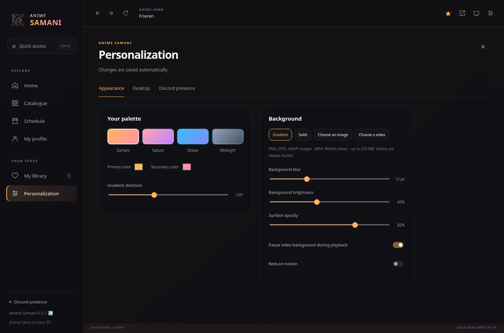

<div align="center">
  
  <h1>Anime Samani</h1>
  <p>Anime Sama on your PC, with a few extras.</p>
  <p><a href="https://github.com/JustAJad/anime-samani/releases">Download</a> · <a href="README.md">Français</a> · <a href="https://github.com/JustAJad/anime-samani/issues/new/choose">Report an issue</a></p>
</div>

Samani brings [Anime Sama](https://anime-sama.to/) to your desktop, with favorites,
a background you can change and Discord presence. Browse the site as usual and
keep the app’s settings close by.

## Installation

For **64-bit Windows 10 or 11**. Open [Releases](https://github.com/JustAJad/anime-samani/releases), expand **Assets**, and choose:

- **Setup** to install the app.
- **Portable** to run it without installing.
- **Windows.zip** to extract everything yourself and open `ANIME_SAMANI.exe`.

These are unsigned preview builds, so Windows may show a publisher warning.
Source code and SHA-256 checksums are included too.

## What’s in the app

- **Favorites** and recent catalogue pages so they’re easy to find again.
- **Image or video backgrounds**, with blur, brightness and opacity controls.
- A few **color palettes**, including the logos’ peach–pink gradient.
- **Cinema mode**, fullscreen and quick access with `Ctrl + K`.
- **Discord presence** with the title and episode, if you want to share them.
- An optional **startup intro**.
- **French and English**, selectable in settings.



*Screenshot using a test page. The catalogue and videos come from Anime Sama.*

## A few useful settings

In **Personalization → Appearance**, pick an image or video smaller than **250 MB**.
Background videos stay muted and can pause while you watch an episode. Samani
keeps a copy on your PC, so moving the original file won’t break the background.
Supported formats are PNG, JPEG, WebP, MP4 and WebM. If a video won’t play, try WebM.

For **Discord**, open the desktop client, then Samani. It’s already configured;
you don’t need a token or password. Settings let you hide the title and episode,
change the text or turn presence off. The preview shows what will be sent; the
connection status tells you whether Discord is ready.

| Shortcut | Action |
| --- | --- |
| `Ctrl + K` | Quick access |
| `Alt + Home` | Home |
| `Alt + ←` / `Alt + →` | Previous / next page |
| `Ctrl + R` | Reload or retry |
| `Ctrl + ,` | Personalization |
| `Ctrl + Shift + F` | Cinema mode; `Esc` to return |
| `F11` | Fullscreen |

## A few things to know

Samani’s favorites stay on your PC and are separate from website favorites.
Recent pages are shortcuts, not second-accurate playback saves. The 0.2 profile
is kept during updates; other older apps aren’t imported automatically.

The language setting applies to the app. Anime Sama’s text and videos keep the
website’s language. A real HTTP 500 or an unavailable player may come from the
website itself. Live playback and a real Discord session still need checking on
each PC. [Need help?](SUPPORT.md)

## Run the project

With [Node.js 24](https://nodejs.org/):

```sh
git clone https://github.com/JustAJad/anime-samani.git
cd anime-samani
npm ci
npm start
```

`npm test` runs the checks. `npm run test:electron` opens the app against test
pages and needs a graphical desktop. `npm run build:win` creates Portable and ZIP
packages; on Windows, `npm run build:win:installer` adds Setup. Files go to `dist/`.

[Contributing](CONTRIBUTING.en.md) · [Changelog](CHANGELOG.md) · [Credits](CREDITS.md)

---

Made with ❤️ by [Jad](https://github.com/JustAJad). Thanks to
[AlexAnimateMp4](https://github.com/AlexAnimateMp4/anime-sama-fr-desktop) for the
original app and [raphael-as](https://github.com/raphael-as/anime-sama-fr-desktop)
for keeping it going.

[MPL-2.0 license](LICENSE). Samani is independent of Anime Sama and Discord.
