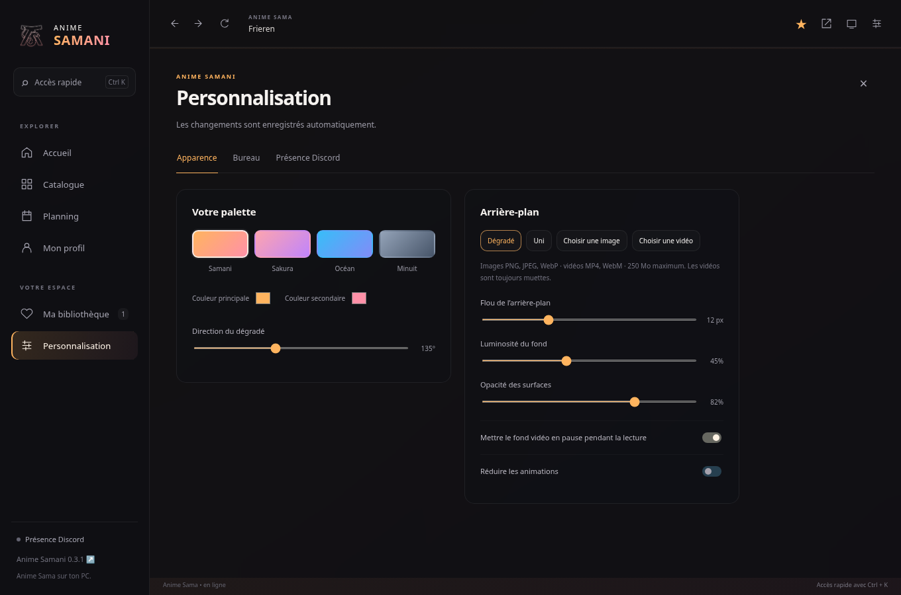

<div align="center">
  
  <h1>Anime Samani</h1>
  <p>Anime Sama, mais en mieux !</p>
  <p><a href="https://github.com/JustAJad/anime-samani/releases">Télécharger</a> · <a href="README.en.md">English</a> · <a href="https://github.com/JustAJad/anime-samani/issues/new/choose">Signaler un souci</a></p>
</div>

Anime Samani est un fork de l'application de [AlexAnimateMp4](https://github.com/AlexAnimateMp4/anime-sama-fr-desktop), qui te donne plus de fonctionalités !

## Installation

Pour **Windows 10 ou 11, en 64 bits**. Dans les [téléchargements](https://github.com/JustAJad/anime-samani/releases), ouvre **Assets** et choisis :

- **Setup** pour installer l’app.
- **Portable** pour la lancer sans installation.
- **Windows.zip** pour tout extraire toi-même, puis ouvrir `ANIME_SAMANI.exe`.

Les versions sont encore en aperçu et ne sont pas signées. Windows peut donc
afficher un avertissement. Le code source et les sommes SHA-256 sont aussi fournis.

## Ce qu’il y a dans l’app

- Des **favoris** et les dernières pages du catalogue pour les retrouver facilement.
- Des **fonds image ou vidéo**, avec flou, luminosité et transparence réglables.
- Quelques **palettes de couleurs**, dont le dégradé pêche–rose des logos.
- Un **mode cinéma**, le plein écran et un accès rapide avec `Ctrl + K`.
- Une **présence Discord** avec le titre et l’épisode, si tu veux les partager.
- Une **intro au démarrage**, que tu peux désactiver.
- Le **français et l’anglais**, au choix dans les réglages.



## Réglages

Dans **Personnalisation → Apparence**, tu peux choisir une image ou une vidéo de
moins de **250 Mo**. Les vidéos de fond restent muettes et peuvent se mettre en
pause pendant un épisode. Samani garde une copie du fichier sur ton PC ; déplacer
l’original ne casse donc pas ton fond. Les formats acceptés sont PNG, JPEG, WebP,
MP4 et WebM. Si une vidéo ne passe pas, essaie un WebM.

Pour **Discord**, ouvre le client de bureau, puis Samani. L’application est déjà
configurée : pas besoin de jeton ni de mot de passe. Dans les réglages, tu peux
masquer le titre et l’épisode, changer le texte ou désactiver la présence.
L’aperçu montre ce qui sera envoyé ; l’état de connexion te dit si Discord est prêt.

| Raccourci | Action |
| --- | --- |
| `Ctrl + K` | Accès rapide |
| `Alt + Home` | Accueil |
| `Alt + ←` / `Alt + →` | Page précédente / suivante |
| `Ctrl + R` | Actualiser ou réessayer |
| `Ctrl + ,` | Personnalisation |
| `Ctrl + Maj + F` | Mode cinéma ; `Échap` pour revenir |
| `F11` | Plein écran |

## À savoir

*Les favoris de Samani restent sur ton PC, à part de ceux du site. Les pages
récentes sont des raccourcis, pas une sauvegarde de la vidéo à la seconde près.
Le profil de la version 0.2 est conservé lors de la mise à jour ; les autres
anciennes apps ne sont pas importées automatiquement.*

*Le choix de langue concerne l’app. Les textes et vidéos d’Anime Sama gardent la
langue du site. Une vraie erreur HTTP 500 ou un lecteur indisponible peut venir
du site lui-même. La lecture en ligne et une vraie session Discord restent à
vérifier sur chaque PC. [Besoin d’aide ?](SUPPORT.md)*

## Pour lancer le projet

Avec [Node.js 24](https://nodejs.org/) :

```sh
git clone https://github.com/JustAJad/anime-samani.git
cd anime-samani
npm ci
npm start
```

`npm test` lance les vérifications. `npm run test:electron` ouvre l’app sur des
pages de test et demande un bureau graphique. `npm run build:win` crée le
portable et le ZIP ; sur Windows, `npm run build:win:installer` ajoute Setup.
Les fichiers arrivent dans `dist/`.

[Contribuer](CONTRIBUTING.md) · [Historique](CHANGELOG.md) · [Crédits](CREDITS.md)

---

Fait avec ❤️ par [Just A Jad](https://github.com/JustAJad). Grand merci à
[AlexAnimateMp4](https://github.com/AlexAnimateMp4/anime-sama-fr-desktop) pour l’app
d’origine et à [raphael-as](https://github.com/raphael-as/anime-sama-fr-desktop)
pour le travail de son propre fork.

***[Licence MPL-2.0](LICENSE). Samani est un projet indépendant non affilié à Anime Sama et Discord.***
